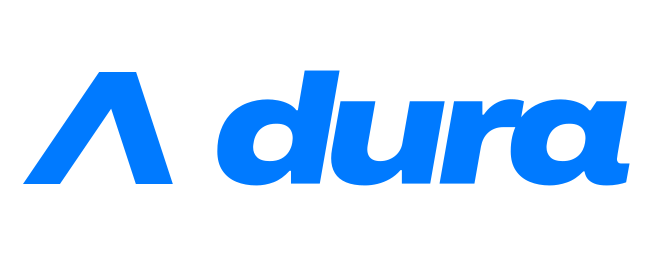

<p align="center">
  
</p>

<p align="center"><b>Un passo, poi la vetta.</b><br>
Piano, allenamenti, scarpe e recupero di un atleta in un posto solo.</p>

---

## Cos'è

Dura è un'app web (installabile sul telefono come app) che mette a confronto
**il piano di allenamento** con **quello che hai corso davvero**, settimana per
settimana, e tiene lo storico di ogni preparazione.

| Sezione | Cosa mostra |
| --- | --- |
| **Piano di allenamento** | Le settimane della preparazione: seduta prevista, corsa registrata su Garmin, scarpa usata, giri veloci e dettaglio completo (mappa, zone cardio, split). Stato di ogni giorno: fatto, mancato, riposo, bonus, gara. |
| **Allenamento** | Piano e reale (sedute e km), forma (zone cardio, training effect) e scarpe con i km di ciascuna. |
| **Lifestyle** | Sonno, HRV e passi. Dati cifrati, visibili solo con la password. |

**Storico delle preparazioni.** In alto si sceglie la gara: quella in corso
(con il conto alla rovescia) oppure una già corsa (con il risultato). Ogni
preparazione conserva il suo piano, così si può sempre tornare agli
allenamenti di una gara passata.

## Come funziona

```
Google Calendar ──(ogni ora)──▶ data/piano.ics ─┐
                                                ├─▶ index.html (GitHub Pages)
Garmin Connect ──(pulsante)───▶ data/*.json ────┘
```

- **Piano**: l'azione `fetch-ics.yml` scarica ogni ora il calendario degli
  allenamenti in `data/piano.ics`.
- **Allenamenti**: il pulsante *Scarica da Garmin* avvia l'azione
  `sync_garmin.yml`, che esegue `scripts/scarica_garmin.py` e pubblica i dati.
- **Dati privati**: percorsi GPS e salute sono cifrati (AES-GCM, chiave da
  password con PBKDF2) prima di arrivare nel repository. La password non è mai
  nel repository.

Nessun server e nessun database: è tutto un sito statico.

## Struttura

```
index.html                  l'app
manifest.json, sw.js        installazione e funzionamento offline
icons/                      logo e icone dell'app
data/
  piano.ics                 piano della preparazione in corso
  preparazioni.json         elenco delle gare (in corso e passate)
  preparazioni/             piani archiviati delle gare passate
  activities.json           corse da Garmin Connect
  gear.json, gear/          scarpe e foto
  gps.enc.json              percorsi GPS, cifrati
  salute.enc.json           sonno, HRV e passi, cifrati
scripts/
  scarica_garmin.py         scarica da Garmin, cifra e pubblica
  garmin_extra.py           dati di salute e zone cardio
  gps_vault.py              cifratura dei dati privati
  backfill_dettagli.py      riscarica i dettagli delle corse passate
  strava_sync.py            allinea le scarpe su Strava (spento)
  strava_autorizza.py       collega Strava una volta sola
.github/workflows/          azioni automatiche
```

## Aggiungere una preparazione

1. Quando una gara è finita, copia il suo piano in
   `data/preparazioni/<gara-anno>.ics`.
2. In `data/preparazioni.json` cambia `piano` della gara finita con il nuovo
   file e aggiungi il `risultato`.
3. Aggiungi la gara successiva con `data`, `obiettivo`, `dal` (primo giorno
   della preparazione) e `piano: "data/piano.ics"`.

## Configurazione

Segreti del repository (Settings → Secrets → Actions):

| Nome | A cosa serve |
| --- | --- |
| `CALENDAR_ICS_URL` | indirizzo privato del calendario degli allenamenti |
| `GARMINTOKENS` | accesso a Garmin Connect (rinnovato a ogni download) |
| `MAP_PASSWORD` | password con cui si cifrano GPS e salute |
| `SECRETS_PAT` | token che permette all'azione di salvare i token rinnovati |

In locale gli stessi valori stanno in `scripts/.env`, che non va mai pubblicato.

## Prossimi passi

Dura nasce per un atleta solo. La direzione è farne il centro degli
allenamenti di qualsiasi atleta:

- caricare il proprio piano (calendario o file) senza toccare il codice;
- storico completo delle corse anche prima di Garmin;
- gestione di gel e integrazione per lunghi e gara;
- account personali, ognuno con i suoi dati.

## Licenza

© 2026 Matteo Mangiarotti. Tutti i diritti riservati. Vedi [LICENSE](LICENSE).
